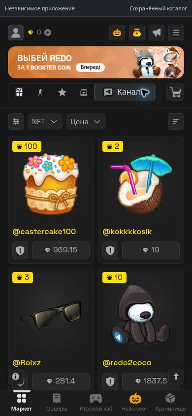

# Gift Catalog — миниапп и бот для Bothost

Один Python-процесс обслуживает сайт, JSON API, Telegram-бота и сбор публичных рыночных данных. Точка входа — `app.py`, production HTTP-сервер — Waitress, адрес — `0.0.0.0`, порт — `PORT` или `3000`.

Это независимое приложение. Сохранённый интерфейс из предыдущей сборки доступен по `/`; подключаемый каталог отображается в основной витрине и по `/catalog`. Покупки, выплаты и игровой сервер MRKT не подключены.

## Обновление интерфейса по материалам 30 октября

- Исправлено отображение собственного профиля: главная страница загружает официальный Telegram SDK, а `POST /api/telegram/me` проверяет подписанный `initData` и возвращает только имя, username и доступное фото. Без валидной подписи показывается гость. Пароли и коды не нужны. Проверка выполняется при открытии миниаппа; после истечения подписи приложение нужно открыть заново.
- Добавлены формы Stars и Premium с предоставленными изображениями, выбором количества/срока и подтверждением получателя. «Отправить себе» использует username подтверждённого посетителя. Стоимость помечена как цена из референса; реальная оплата/доставка не подключена, успех не имитируется.
- Из скриншотов перенесены 28 каналов и 35 визуальных пунктов фильтра. У девяти пунктов исходник не содержит названий — описание изображения используется в подписи для доступности; видимый текст оставлен пустым, как в исходнике. Поиск, выбор/сброс коллекций, диапазон цены и сортировка работают локально. Котировки и владение каналами не подтверждены.
- Lucky Buy из Halloween открывает страницу с описанием, топами трёх подарков и трёх скинов. Данные сохранены из предоставленного референса, розыгрыши не выполняются.
- Для Lol Pop #285611 добавлены атрибуты, сохранённый график и три события со скриншотов. Для остальных предметов не создаются вымышленные графики или история. Офферы можно просматривать как раздел, отправка торговых предложений не подключена.
- Жалобы сохраняются в отдельной приватной таблице SQLite и доступны владельцу через кнопку в `/admin`. Повтор определяется по пользователю и карточке. Это жалобы модератору данного приложения, не отправка жалобы в Telegram/MRKT. Для отправки нужен подписанный профиль Telegram.
- Экран загрузки использует хеллоуинскую композицию, собственную надпись GIFTS и анимации; режим уменьшенного движения соблюдается. Нижняя навигация сохраняет общий размер. Игровой хаб показывает экран временной недоступности. В CS2 отображается только анимированный индикатор, без технического текста; навигация остаётся доступна.

Это обновление сохранённого каталога. Прямой авторизованный клиент из `tgmrkt-api`/`boostNT/MRKT-API`, живые CS2 и игровые события не подключались; исходные ссылки описывают возможность чтения NFT, но не дают готовый проверенный источник для всех трёх разделов.

## Исправление карточек и подключение основной витрины

- Пересобраны 8 крупных иллюстраций каналов и 35 иконок фильтра с прозрачным фоном. Удалены фрагменты старых карточек, счётчиков и username; изображения выровнены на общей площади.
- Из основной витрины убрана ссылка «Каталог API». Индикатор источника различает сохранённый каталог и данные серверной базы.
- `market-sync.js` читает публичный `/api/catalog` напрямую, независимо от запрета торговых операций. Серверные объявления заменяют сохранённые карточки в основной витрине; пагинация, повторная загрузка при возврате и опрос каждые 15 секунд работают без перезагрузки страницы. Суммы исходного каталога отображаются в TON.
- При отсутствующем источнике сохраняется референс; ошибка не удаляет последнюю удачно загруженную страницу. Наличие этого подключения не означает, что весь живой каталог MRKT уже импортирован: для сбора нужен настроенный разрешённый источник.



## Запуск на Bothost

1. Создайте Telegram-бота в Bothost и укажите этот Git-репозиторий, ветку `main`.
2. Выберите Python 3.12, главный файл **`app.py`**.
3. Включите **«Использовать домен»**, внутренний порт **3000**. Bothost передаст его в `PORT`.
4. Разверните приложение. По назначенному HTTPS-домену откроется миниапп, по `/health` — проверка сервера.
5. Напишите боту `/start`: он отправит кнопки миниаппа и каталога API.

Bothost передаёт `BOT_TOKEN` и `DOMAIN` автоматически. Также поддерживаются имена `TELEGRAM_BOT_TOKEN`, `API_TOKEN`, `TOKEN` и явный `PUBLIC_URL`. Токены в Git не добавляются. Без токена сервер и страницы запускаются, но бот не отправляет сообщения. Без домена бот объясняет, что нужно включить домен в Bothost.

Официальные инструкции: [веб-приложения](https://bothost.ru/docs/web-apps-domains), [порт и домен](https://bothost.ru/docs/domains-and-ports), [переменные окружения](https://bothost.ru/docs/environment-variables).

## Меню владельца

Команда `/clezzy1488` открывает инлайн-меню. Настройки защищены Telegram ID владельца; сама команда не является паролем.

1. Напишите `/id` своему боту.
2. Укажите полученный ID в **`ADMIN_TELEGRAM_ID`** в переменных окружения Bothost.
3. Перезапустите приложение и отправьте `/clezzy1488`.

Доступны кнопки статуса, инструкции подключения API, запуска, остановки, обновления каталога и веб-панели `/admin`. Веб-панель проверяет подпись `Telegram.WebApp.initData` и ID владельца на сервере. Открытие URL без подтверждённого владельца не даёт управления.

**Вход по номеру телефона, сбор кодов Telegram, паролей 2FA и пользовательских сессий не реализованы.** Бот не сохраняет произвольные сообщения, номера телефонов или коды. Обычное подтверждение личности владельца в Mini App не даёт доступа к его Telegram-перепискам или аккаунту.

## Подключение рыночных данных

Нужен партнёрский ключ **`SWIFT_API_KEY`** с разрешением на используемые маршруты. Добавьте его только в окружение Bothost, перезапустите приложение, затем нажмите «Запустить» в меню владельца.

Используется документированный read-only доступ Swift к MRKT:

- `POST /api/aggregator?page=N&limit=200`, тело `{ "market": ["mrkt"], "sort_by": "price asc" }` — постраничная сверка объявлений;
- `GET /api/realtime/markets?market=mrkt&type=listing|buy|change_price` — три серверных SSE-потока публичных событий;
- авторизация — заголовок `X-API-KEY`, ключ не передаётся в браузер, URL или сообщения бота.

Документация: [начало работы](https://doc.swiftgifts.tg/developer-guide/getting-started), [актуальный контракт](https://partners.swiftgifts.tg/docs/swagger.json).

Цены API показываются в **TON**. Они не выдаются за GRAM из сохранённых экранов. В истории сохраняются наблюдаемые публичные поля; транзакционные payload, секреты и личные сессии не сохраняются.

По умолчанию обход ограничен 25 страницами, интервал между обходами — 60 секунд. Между запросами страниц выдерживается пауза, HTTP 429 учитывает `Retry-After`. Переменные `SYNC_MAX_PAGES` (1–1001) и `SYNC_INTERVAL` (минимум 30 секунд) регулируют нагрузку в пределах разрешений провайдера. Событийные потоки переподключаются после обрывов; восстановление всех пропущенных событий и всей старой истории не гарантируется источником. Каталог в браузере обновляется раз в 10 секунд.

Неполный, ограниченный или ошибочный обход не удаляет отсутствующие в нём объявления из базы. Успешный полный обход помечает ранее видимые, но более не найденные объявления как неактивные. При сбое остаётся кеш с датой наблюдения. Состояние полноты и ошибки показываются явно. «Всё в реальном времени без пропусков» не обещается: это зависит от покрытия API, его кеша, лимитов и доступности.

Игровые раунды и лидерборды в сохранённом интерфейсе остаются локальными записями. SSE рыночных событий не является доступом к игровому серверу MRKT. Платёжных маршрутов и отправки ставок нет.

## База данных

SQLite хранится в `DATA_DIR/market.sqlite3`. На Bothost по умолчанию используется `/app/data`, вне Bothost — `data/` рядом с приложением. Там сохраняются объявления, история изменений, курсор Telegram и настройка запуска сбора. Папка исключена из Git. Используйте постоянное хранилище и резервные копии Bothost.

Публичные API: `/api/status`, `/api/catalog?limit=100&offset=0`, `/api/events?after=0`. Административный экспорт истории — `POST /api/admin/events` с проверенным `initData` и курсором `after`, до 1000 событий за запрос. Любые административные действия требуют владельца. Персональные данные аккаунта для этих функций не нужны.

## Frontend в репозитории

Frontend и изображения находятся в проверяемом архиве, разбитом на бинарные части в `site_bundle/`. Это позволяет хранить одну сборку сайта без тяжёлого монолитного HTML и тысяч отдельных загрузок изображений. `prepare_site.py` сверяет SHA-256 частей и архива, защищает пути распаковки и автоматически создаёт `public/` при первом запуске. Интернет для распаковки не нужен. Повторный запуск не распаковывает неизменённую сборку.

Новые изменения хранятся обычными файлами в `frontend_patch/` с той же структурой путей, что и `public/`. Они применяются после распаковки и при повторном запуске, поэтому обновление Bothost использует актуальные JS, CSS, HTML и ассеты без повторной загрузки большого базового архива. Для редактирования этой версии меняйте `frontend_patch/`, затем выполняйте `python prepare_frontend.py unpack` для локальной проверки. Генерируемый `public/` не коммитится.

Изменение frontend локально: выполните `python prepare_frontend.py unpack`, редактируйте `public/`, затем `python prepare_frontend.py pack` и закоммитьте обновлённые части и манифест. Секреты и базу данных в `public/` не помещайте.

## Локальный запуск и проверки

```bash
python -m venv .venv
.venv/bin/pip install -r requirements.txt
python prepare_frontend.py unpack
.venv/bin/python app.py
```

Windows: используйте `.venv\Scripts\python.exe` и `.venv\Scripts\pip.exe`. По умолчанию сервер доступен на `http://127.0.0.1:3000/`. Для кнопок Telegram нужен HTTPS-домен Bothost.

```bash
.venv/bin/python -m unittest discover -s tests -v
```

Проверки не подключаются к настоящему Telegram или платному API. Используются подменённые ответы и тестовые подписи. В GitHub Actions проверяются сборка frontend, Python и тесты. Запускайте один экземпляр бота с одним токеном: используется long polling; при старте старый webhook удаляется без удаления ожидающих обновлений.
